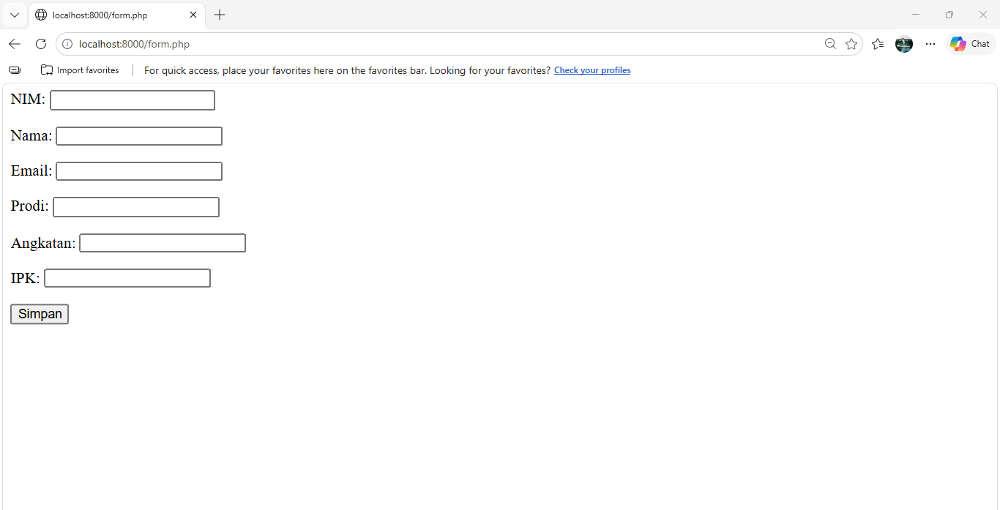
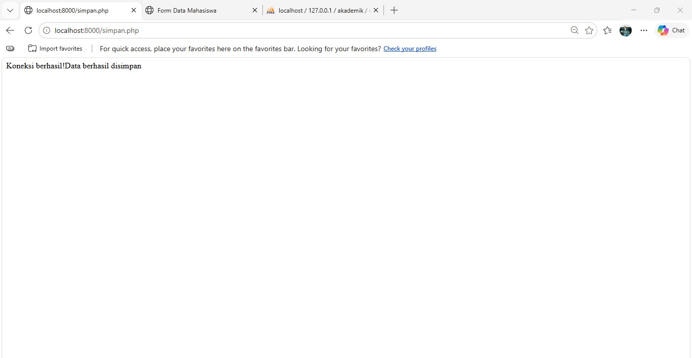
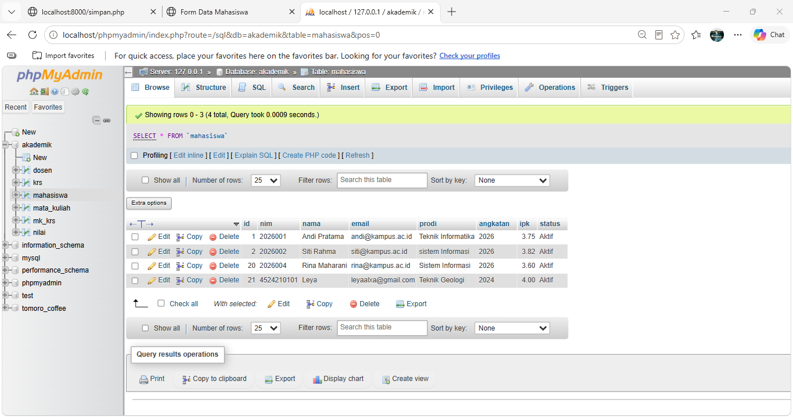
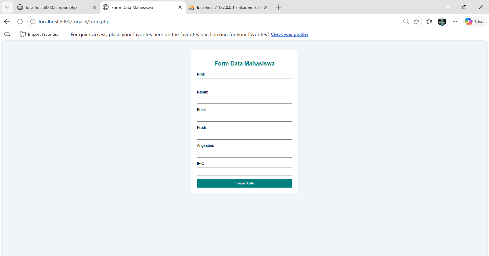
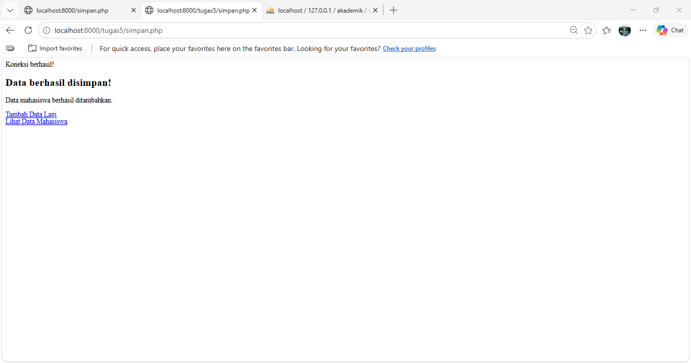
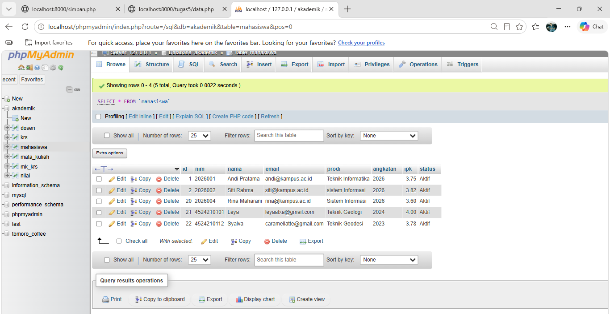

# Tugas Pertemuan 5 — Pemrograman Berbasis Web

## 1. Deskripsi Tugas

Tugas Pertemuan 5 membahas pembuatan form data mahasiswa menggunakan PHP dan MySQL. Program ini digunakan untuk memasukkan data mahasiswa ke database dan menampilkan data yang telah disimpan.

File yang digunakan:
- `form.php`
- `koneksi.php`
- `simpan.php`
- `data.php`

Database yang digunakan adalah `akademik`, dengan tabel `mahasiswa`.

## 2. Modifikasi Kode

### A. Modifikasi pada `form.php`

Modifikasi yang dilakukan:

1. **Penambahan CSS:** mengubah tampilan form agar lebih rapi dengan warna latar belakang, kotak form berwarna putih, dan tombol berwarna teal.
2. **Validasi input:** menambahkan batas panjang NIM dan nama, batas panjang email, rentang angkatan 2000–2100, serta rentang IPK 0–4.
3. **Perubahan tombol:** mengubah tulisan tombol dari "Simpan" menjadi "Simpan Data".

### B. Modifikasi pada `simpan.php`

Modifikasi yang dilakukan:

1. **Validasi data:** memeriksa NIM, nama, email, program studi, angkatan, dan IPK sebelum data disimpan ke database.
2. **Prepared statement:** menggunakan `mysqli_prepare()` dan `mysqli_stmt_bind_param()` untuk menjalankan query INSERT dengan parameter.
3. **Pesan hasil penyimpanan:** menampilkan pesan ketika data berhasil atau gagal disimpan, serta menyediakan tautan untuk kembali ke form dan melihat data mahasiswa.

## 3. Penjelasan Lima Bagian Kode Penting

### 1. Koneksi Database (`koneksi.php`)

Fungsi `mysqli_connect()` digunakan untuk menghubungkan PHP dengan database MySQL. Program memeriksa apakah koneksi berhasil. Jika koneksi gagal, program menampilkan pesan kesalahan.

### 2. Form Input (`form.php`)

Form digunakan untuk menerima data mahasiswa, seperti NIM, nama, email, program studi, angkatan, dan IPK. Atribut `action="simpan.php"` menentukan file yang memproses data, sedangkan `method="post"` digunakan untuk mengirim data melalui metode POST.

### 3. Validasi Input (`simpan.php`)

Validasi digunakan untuk memastikan data yang dimasukkan sesuai ketentuan. Contohnya, format email harus valid, angkatan harus berada pada rentang 2000–2100, dan IPK harus berada pada rentang 0–4.

### 4. Prepared Statement (`simpan.php`)

`mysqli_prepare()` digunakan untuk menyiapkan query SQL dengan parameter. Selanjutnya, `mysqli_stmt_bind_param()` memasangkan nilai input dengan parameter tersebut sebelum query dijalankan. Cara ini membantu mencegah input pengguna diperlakukan sebagai bagian dari perintah SQL.

### 5. Menampilkan Data (`data.php`)

Perintah `SELECT` digunakan untuk mengambil data mahasiswa dari database. Fungsi `mysqli_fetch_assoc()` digunakan untuk membaca hasil query per baris sehingga data dapat ditampilkan pada halaman web.

## 4. Screenshot Sebelum dan Sesudah Modifikasi

### A. Sebelum Modifikasi

**1. Form data mahasiswa sebelum modifikasi**

**2. Proses penyimpanan sebelum modifikasi**

**3. Data mahasiswa sebelum modifikasi**

### B. Sesudah Modifikasi

**1. Form data mahasiswa sesudah modifikasi**

**2. Proses penyimpanan sesudah modifikasi**

**3. Data mahasiswa sesudah modifikasi**

**Penyebab:**

PHP tidak dapat menemukan file `koneksi.php` ketika `simpan.php` dijalankan. Hal ini dapat terjadi karena file berada di folder yang berbeda dari lokasi yang dipanggil oleh program.

**Langkah perbaikan:**

1. Memeriksa lokasi file `simpan.php` dan `koneksi.php`.
2. Memastikan kedua file berada di folder yang sesuai.
3. Jika `koneksi.php` berada di folder yang sama, gunakan `require_once "koneksi.php";`.
4. Jika `koneksi.php` berada satu tingkat di atas folder `tugas5`, gunakan `require_once "../koneksi.php";`.
5. Menjalankan kembali program dan memastikan pesan error tidak muncul.

## 6. Kesimpulan

Melalui tugas ini, saya mempelajari cara menghubungkan PHP dengan database MySQL, menerima input data mahasiswa melalui form, melakukan validasi data, menyimpan data menggunakan prepared statement, dan menampilkan data dari database. Modifikasi dilakukan untuk meningkatkan tampilan form, validasi input, dan keamanan proses penyimpanan data.