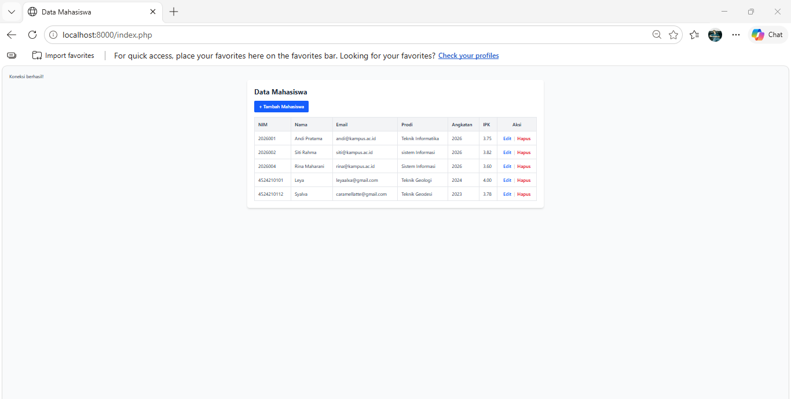
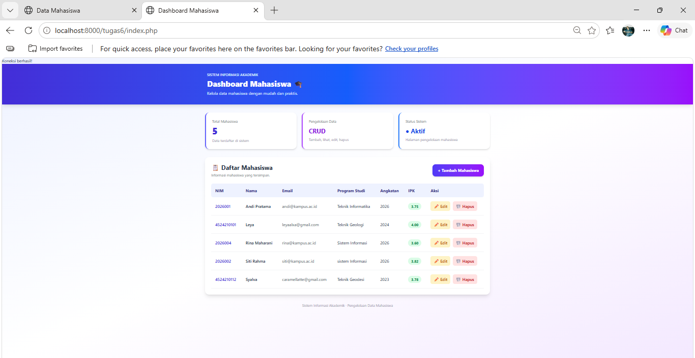
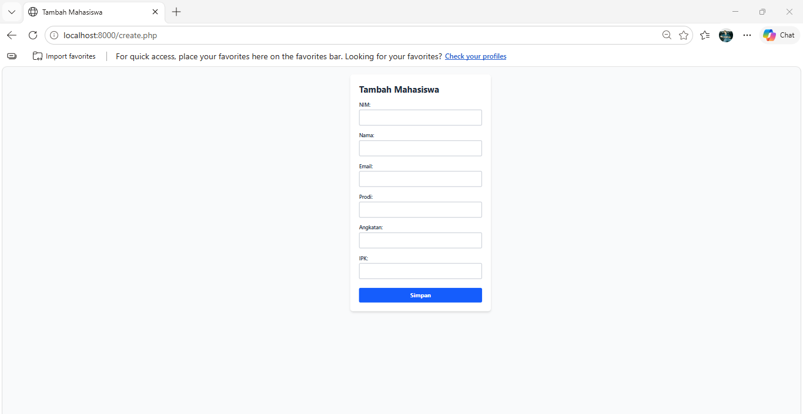
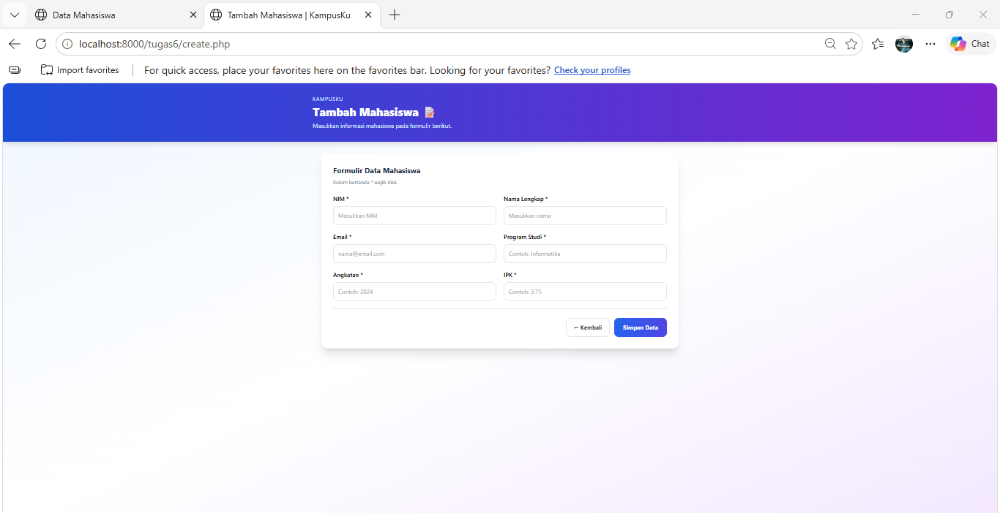
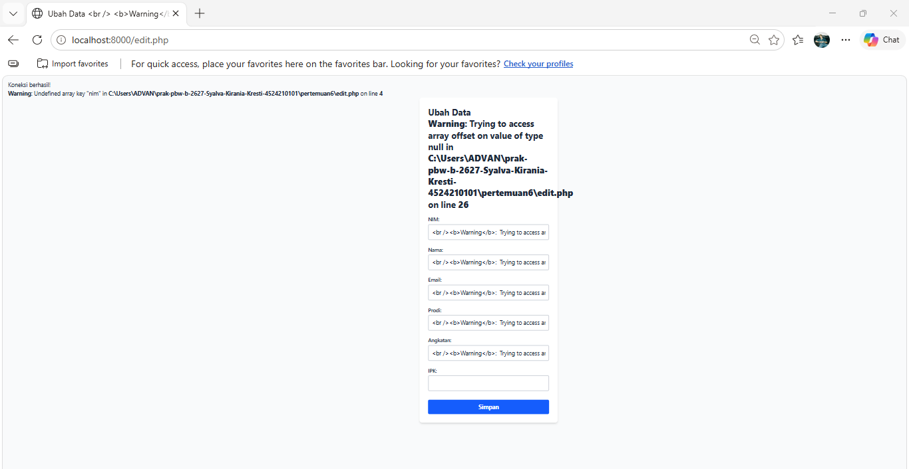
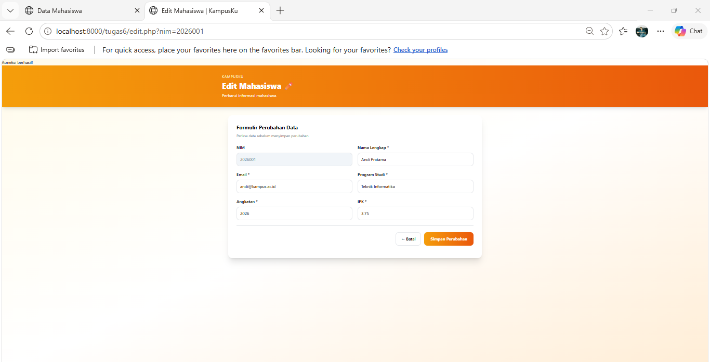
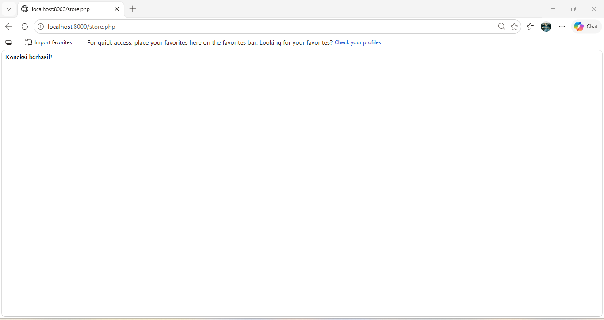
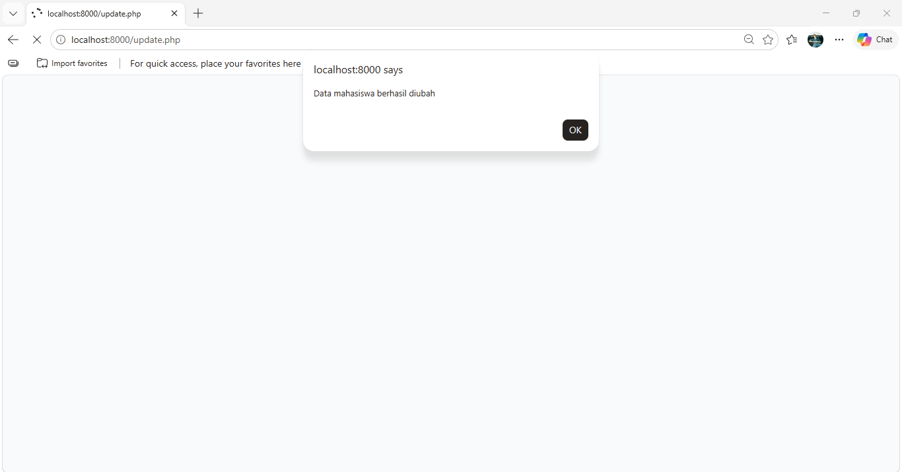
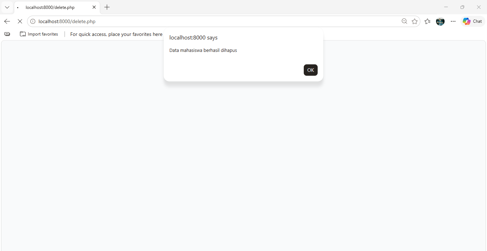

# Laporan Praktikum PBW — Pertemuan 6
## CRUD Data Mahasiswa Menggunakan PHP dan MySQL

### 1. Tujuan Praktikum

Tujuan praktikum ini adalah memahami penerapan operasi CRUD (*Create, Read, Update, Delete*) menggunakan PHP dan MySQL untuk mengelola data mahasiswa melalui aplikasi berbasis web.

### 2. Deskripsi Praktikum

Pada praktikum ini dibuat aplikasi pengelolaan data mahasiswa menggunakan PHP dan database MySQL. Aplikasi menyediakan fitur untuk menampilkan, menambahkan, mengubah, dan menghapus data mahasiswa.

Data mahasiswa yang dikelola meliputi NIM, nama, email, program studi, angkatan, dan IPK. Tampilan aplikasi juga dimodifikasi agar lebih menarik dan mudah digunakan.

### 3. Teknologi yang Digunakan

- PHP sebagai bahasa pemrograman sisi server.
- MySQL sebagai database.
- HTML sebagai struktur halaman web.
- Tailwind CSS untuk mempercantik tampilan.
- XAMPP dan phpMyAdmin untuk menjalankan server lokal dan mengelola database.

### 4. Fitur Aplikasi

Aplikasi ini memiliki beberapa fitur, yaitu:

1. **Read:** Menampilkan daftar data mahasiswa.
2. **Create:** Menambahkan data mahasiswa baru.
3. **Update:** Mengubah data mahasiswa yang sudah tersimpan.
4. **Delete:** Menghapus data mahasiswa.
5. Menampilkan jumlah data mahasiswa pada halaman utama.
6. Mengurutkan data mahasiswa berdasarkan nama.
7. Memvalidasi input, seperti format email, angkatan, dan IPK.
8. Memeriksa NIM agar tidak terjadi duplikasi.
9. Menggunakan prepared statement untuk membantu mengamankan query database.
10. Menampilkan notifikasi setelah proses tambah, ubah, atau hapus data berhasil.

### 5. Struktur File

File-file yang digunakan dalam praktikum ini adalah:

- `index.php` — Menampilkan daftar mahasiswa dan halaman utama aplikasi.
- `create.php` — Menampilkan formulir untuk menambahkan mahasiswa.
- `store.php` — Memproses penyimpanan data mahasiswa baru.
- `edit.php` — Menampilkan formulir untuk mengubah data mahasiswa.
- `update.php` — Memproses perubahan data mahasiswa.
- `delete.php` — Memproses penghapusan data mahasiswa.
- `koneksi.php` — Menghubungkan aplikasi PHP dengan database MySQL.
- `screenshots/` — Menyimpan dokumentasi hasil praktikum.

### 6. Modifikasi yang Dilakukan

Modifikasi dilakukan untuk mengembangkan contoh program praktikum agar lebih menarik dan memiliki validasi yang lebih baik.

**Modifikasi 1 — Tampilan Antarmuka**

- Mengubah tampilan halaman menggunakan kombinasi warna dan gradasi.
- Memperbaiki tampilan formulir tambah dan edit data.
- Menambahkan tombol dengan warna berbeda untuk membedakan tindakan.
- Membuat tampilan halaman lebih rapi dan mudah digunakan.

**Modifikasi 2 — Validasi dan Pengolahan Data**

- Menambahkan validasi input pada data mahasiswa.
- Memeriksa format email.
- Memvalidasi nilai angkatan dan IPK.
- Memeriksa NIM yang sudah terdaftar agar tidak terjadi duplikasi.
- Menggunakan prepared statement dalam query database.

**Modifikasi Tambahan**

- Menampilkan jumlah mahasiswa pada halaman utama.
- Mengurutkan daftar mahasiswa berdasarkan nama.
- Menampilkan notifikasi setelah proses CRUD berhasil.

### 7. Pengujian Aplikasi

Pengujian dilakukan dengan mencoba fitur-fitur utama aplikasi untuk memastikan bahwa data mahasiswa dapat dikelola.

| No. | Fitur yang Diuji | Hasil yang Diharapkan |
|---|---|---|
| 1 | Menampilkan data mahasiswa | Data mahasiswa tampil pada halaman utama. |
| 2 | Menambahkan data mahasiswa | Data baru tersimpan dan ditampilkan. |
| 3 | Mengubah data mahasiswa | Data yang dipilih berhasil diperbarui. |
| 4 | Menghapus data mahasiswa | Data yang dipilih berhasil dihapus. |
| 5 | Validasi input | Input yang tidak sesuai ditolak atau menampilkan pesan kesalahan. |
| 6 | Pemeriksaan NIM | NIM yang sudah terdaftar tidak dapat ditambahkan kembali. |

### 8. Dokumentasi Screenshot

#### 8.1 Halaman Utama Sebelum Modifikasi

#### 8.2 Halaman Utama Setelah Modifikasi

#### 8.3 Form Tambah Sebelum Modifikasi

#### 8.4 Form Tambah Setelah Modifikasi

#### 8.5 Form Edit Sebelum Modifikasi

#### 8.6 Form Edit Setelah Modifikasi

#### 8.7 Proses Tambah Data

#### 8.8 Proses Update Data

#### 8.9 Proses Hapus Data

### 9. Kesimpulan

Berdasarkan praktikum yang telah dilakukan, aplikasi pengelolaan data mahasiswa dapat dikembangkan menggunakan PHP dan MySQL dengan menerapkan operasi CRUD. Aplikasi ini memungkinkan pengguna menambah, melihat, mengubah, dan menghapus data mahasiswa.

Modifikasi pada tampilan, validasi input, pemeriksaan NIM, dan pengolahan query membuat aplikasi lebih terstruktur dan nyaman digunakan. Praktikum ini juga membantu memahami hubungan antara PHP dan database MySQL dalam membangun aplikasi web dinamis.
