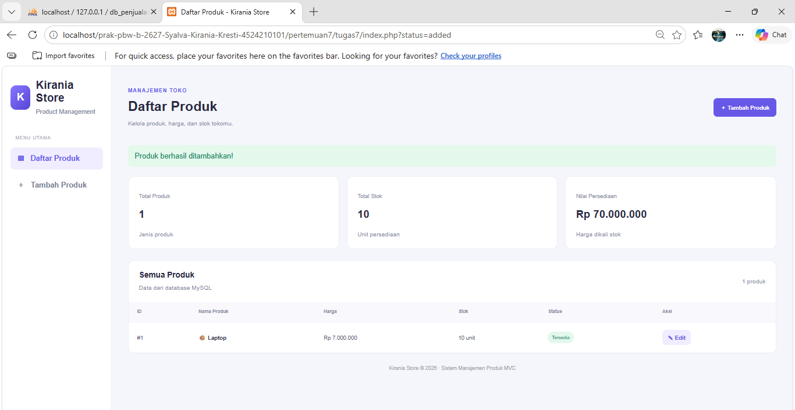
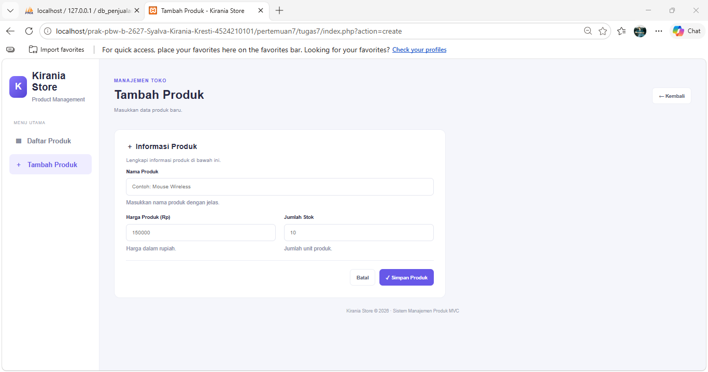
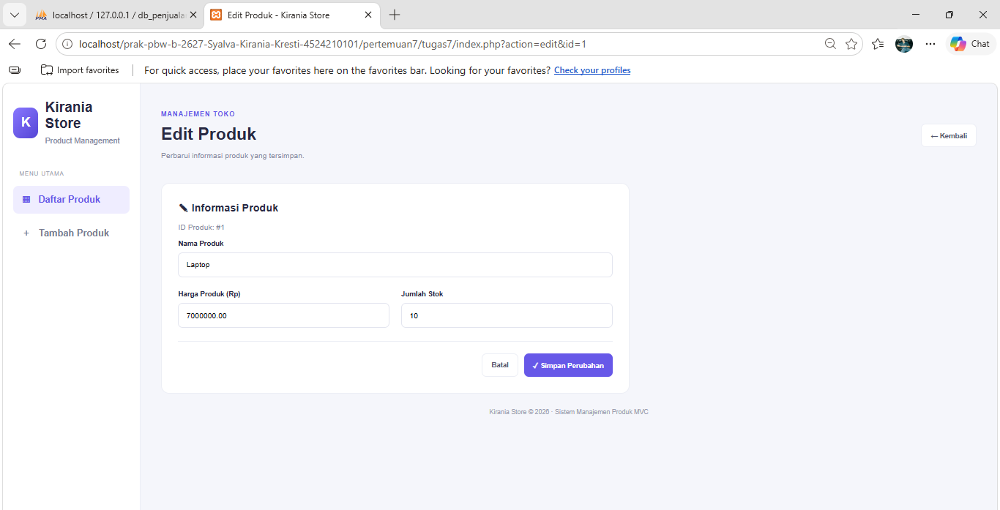
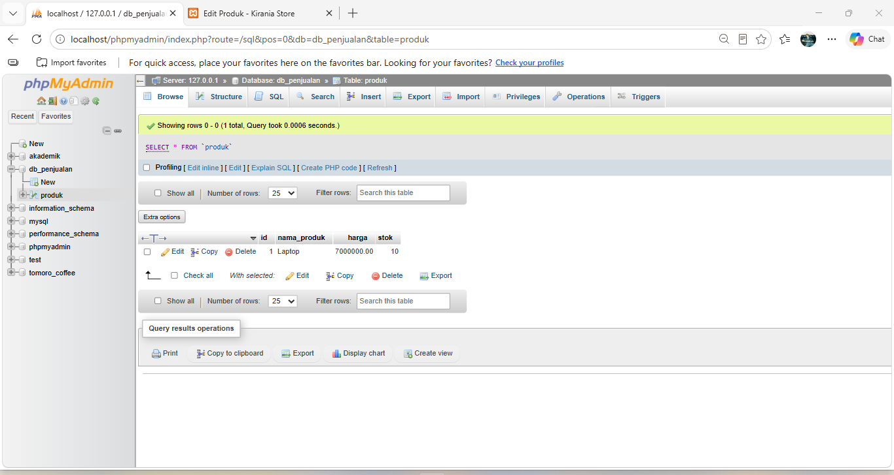

# Tugas 7 – Sistem Manajemen Produk Berbasis MVC

## 1. Deskripsi Program

KiraStore merupakan aplikasi sederhana untuk mengelola data produk toko menggunakan PHP, MySQL, dan konsep Model-View-Controller (MVC). Aplikasi ini dibuat untuk memenuhi tugas praktikum Pemrograman Berbasis Web.

## 2. Teknologi yang Digunakan

- PHP 8
- MySQL
- phpMyAdmin
- HTML dan CSS
- XAMPP
- Visual Studio Code

## 3. Struktur Folder

```text
tugas7/
├── index.php
├── koneksi.php
├── controllers/
│   └── ProdukController.php
├── models/
│   └── ProdukModel.php
├── views/
│   ├── index.php
│   ├── create.php
│   └── edit.php
├── screenshots/
└── README.md
```

## 4. Fitur Program

1. Menampilkan daftar produk yang tersimpan di database.
2. Menambahkan produk baru dengan nama, harga, dan stok.
3. Mengedit data produk yang sudah tersimpan.
4. Memvalidasi input nama produk, harga, dan stok.
5. Menampilkan status stok produk berdasarkan jumlah persediaan.
6. Menampilkan ringkasan total produk, total stok, dan nilai persediaan.

## 5. Penerapan Konsep MVC

- **Model (`ProdukModel.php`)**: Mengelola data produk melalui query database, termasuk mengambil, menambahkan, dan memperbarui data.
- **View (`views/`)**: Menampilkan antarmuka aplikasi, daftar produk, formulir tambah produk, dan formulir edit produk.
- **Controller (`ProdukController.php`)**: Mengatur alur aplikasi, memproses input pengguna, melakukan validasi, dan memanggil Model.
- **Entry Point (`index.php`)**: Menjadi titik masuk aplikasi dan mengarahkan permintaan ke Controller berdasarkan parameter aksi.
- **Koneksi (`koneksi.php`)**: Menghubungkan aplikasi PHP dengan database MySQL.

## 6. Struktur Database

Nama database: `db_penjualan`

Nama tabel: `produk`

| Kolom | Tipe Data | Keterangan |
|---|---|---|
| id | INT | Primary key dan auto increment |
| nama_produk | VARCHAR(100) | Nama produk |
| harga | DECIMAL(12,2) | Harga produk |
| stok | INT | Jumlah stok produk |

### SQL Pembuatan Database

```sql
CREATE DATABASE IF NOT EXISTS db_penjualan;
USE db_penjualan;

CREATE TABLE IF NOT EXISTS produk (
    id INT AUTO_INCREMENT PRIMARY KEY,
    nama_produk VARCHAR(100) NOT NULL,
    harga DECIMAL(12,2) NOT NULL,
    stok INT NOT NULL
);
```

## 7. Cara Menjalankan Program

1. Pastikan XAMPP sudah terpasang.
2. Simpan folder `tugas7` di dalam direktori `htdocs` pada XAMPP.
3. Jalankan Apache dan MySQL melalui XAMPP Control Panel.
4. Buka phpMyAdmin melalui `http://localhost/phpmyadmin/`.
5. Buat database `db_penjualan` dan tabel `produk` menggunakan SQL pada bagian sebelumnya.
6. Pastikan konfigurasi database pada `koneksi.php` sesuai dengan pengaturan MySQL.
7. Buka aplikasi melalui browser menggunakan URL proyek, misalnya `http://localhost/tugas7/`.
8. Tambahkan produk melalui tombol **Tambah Produk**.
9. Uji fitur edit melalui tombol **Edit** pada daftar produk.
10. Periksa hasil penyimpanan data melalui phpMyAdmin pada tabel `produk`.

## 8. Screenshot Hasil Program

### A. Halaman Daftar Produk



### B. Form Tambah Produk



### C. Form Edit Produk



### D. Data Produk pada Database



## 9. Kesimpulan

Melalui tugas ini, konsep Model-View-Controller (MVC) diterapkan untuk memisahkan pengelolaan data, tampilan, dan alur program. Aplikasi KiraStore dapat digunakan untuk menampilkan, menambahkan, dan mengedit data produk yang tersimpan dalam database MySQL. Validasi input juga diterapkan untuk membantu menjaga data yang dimasukkan tetap sesuai dengan ketentuan program.
